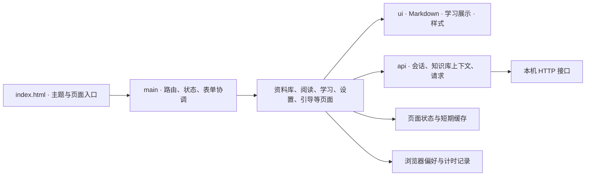

# 网页架构地图

本文只覆盖本机网页客户端。入口是 `public/index.html`，依次加载 `public/web/theme.js`、网页样式和 `public/web/main.mjs`；HTML/CSS/JavaScript 使用浏览器原生能力与 ES 模块，无构建步骤。实际静态、动态模块依赖以 `node scripts/check-architecture.mjs --json` 的输出为准；依赖图是定位工具，不等于运行时、可达功能或验收结论。界面规范见 [UI 指南](UI-DESIGN.md)。

## 模块落点

- `main.mjs` 持有页面路由、页面状态、导航及未保存输入保护；它装配业务模块并分发动作。路由由片段标识决定，页面函数返回 HTML 与可选绑定函数。`library-page.mjs` 管理知识库的读取、筛选、偏好与返回快照，知识库和关系页共享 `knowledge-display.mjs` 中的建议展示。`search-page.mjs` 管理检索表单、授权选择与结果分页，也处理侧栏主题发起的查询。`parity.mjs` 仍集中主题、关系和历史等页面；设置、维护在 `management.mjs`，用量页按需加载 `usage-dashboard.mjs`。
- 阅读入口在 `reader.mjs`。`reader-data.mjs` 以 `public/source-membership.mjs` 组织即时成员投影，随后取得详情和关系。`reading-content.mjs` 展示正文，`reader-actions.mjs` 管理阅读操作与学习条件。`note-editor.mjs` 接入 `public/markdown-editor.mjs`，保存时核对内容版本。同一知识空间内，从阅读进入同一资料的编辑再返回，会记住原来的阅读来源。
- 收集由主入口、`capture-files.mjs` 和 `batch-import.mjs` 协调，加工面板由 `process-outcome.mjs` 展示。学习池、学习会话与离开时的轮询清理由 `study-workspace.mjs` 管理，页面实际挂载后才发布当前会话。两代网页通过 `public/study-start.mjs` 管理开始学习的请求身份。反馈、轮询和学习辅助分别在 `learning-display.mjs`、`study-feedback.mjs`、`study-aid.mjs`。计时器、状态转换与表盘分别在 `focus.mjs`、`focus-model.mjs`、`focus-dial.mjs`。
- 引导由 `onboarding.mjs` 编排，步骤、目标、复习、输出、重学、对话与动效分属 `onboarding-*`；引导读取练习材料并通过请求层切换知识空间，不把引导状态等同正式学习结果。
- `ui.mjs` 提供共享控件、转义后的展示、分页及弹窗；`markdown.mjs` 负责文本渲染和链接限制。样式从入口依次载入 `prototype.css`、`styles.css`、`features.css`、`focus.css`、`controls.css`、`onboarding.css`；用量页另按需载入自己的样式。令牌与参考组件位于 `web/cds/`。类名与加载顺序影响覆盖关系，改共享控件时要同时检查使用页面、深浅色和窄屏。

## 状态、请求与失效

- 主入口的 `state` 管路由、初始化数据、未保存状态、保存中计数、阅读返回位置、学习会话和滚动位置。导航有自己的序列，页面异步结果只写入仍属于该次导航的页面。首页刷新和加工面板共享初始化数据发布顺序，按知识空间版本和最近成功发布的请求检查。加工面板还要求弹窗仍是当前弹窗。应用当前快照和导航到目标页是两项不同操作。
- `api.mjs` 将会话令牌保存在内存。`practiceId` 标识练习空间，`version` 随知识空间切换，`revision` 随成功写入递增。请求进行中拒绝切换，旧空间的响应无法使用。仅会话过期且在路由前被拒绝的 GET 最多重新建会话并重读一次。写入和其他错误由相应页面呈现。
- 阅读缓存限于内存，按知识空间、成功写入和初始化快照变化失效，并合并相同详情的并发请求。知识库按空间与写入版本复用已绑定的节点。显式刷新开始时清除快照，旧访问无法重新填入，引导会重新渲染。资料原件的权威位置见[服务端架构](ARCHITECTURE.md)。
- 检索响应及错误提示同时受当前页面和请求顺序约束。加载下一页沿用已显示结果的查询条件及游标。新查询进行时旧结果暂不可操作，失败后可以继续浏览旧页。学习反馈轮询仅随当前可见会话读取，离开即停止。
- 浏览器 `localStorage` 保存主题、强调色、知识库筛选和引导偏好；计时器记录按资料目录区分并以 Web Locks 协调。`sessionStorage` 的学习辅助标记按学习会话和回答轮次区分。浏览器存储不可用时各模块的表现不同：偏好可回退内存，计时记录读写失败则提示，不能统一吞掉错误。它们不等于服务端资料或完整备份。
- 基础设置验证已保存的连接。高级设置测试当前单项输入，再用这次测试的回执确认保存。`public/capability-test.mjs` 核对保存结果，输入在结果不明确时保留。保存处理中改写的草稿继续显示为未保存。正式保存成功后的引导更新提示显示在原表单。
- 恢复的前端绑定由 `public/restore-selection.mjs` 管理，确认使用当前文件、面板、知识空间和该次预览的凭据。新旧网页保持各自的文件读取时机。设置、外发、续传和回执的长期语义见[业务边界](ARCHITECTURE_PROGRESS.md#长期业务边界)。

## 并行实现与决定

`public/web/` 是当前网页入口，根目录下仍有被当前页面复用的材料、编辑器或独立说明页；旧页面文件是否可移除须按实际依赖和路由核对，不能按目录一刀删除。旧 `public/api.mjs` 与 `web/api.mjs`、旧 DOM 控件与新模板字符串控件，拥有不同会话、上传、错误和输出约定；同名不能当成相同接口。`web/markdown.mjs` 的展示渲染与其他编辑/阅读实现也承担不同职责，不能因重复名称合并。任何遗留代码清理须同时核对独立页面、静态资源和测试的真实调用方。

资料类型、学习阶段和深度由 `public/note-classification.mjs` 定义，`web/classification.mjs` 从中生成各视图的显示选项；可练习的阶段子集也来自共享定义，资料是否已被替代等条件由相应入口判断。已删除 `main.mjs` 中被现行路由接管的旧知识库、检索、任务、建主题、打开主题和打开草稿实现。通用控件和分页从业务页移至 `ui.mjs`，学习反馈、完成证据和来源展示移至 `learning-display.mjs`；保留既有样式类、空态及链接处理。批次和验证见[治理进度](ARCHITECTURE_PROGRESS.md)。

## 后续改动

从调用方、数据和退出条件识别可独立的业务流程。`check-architecture.mjs` 检查网页入口对知识库、检索和剩余业务页面的装配边界。跨页复用直接引用控件或展示模块。预览验证使用各自的合成库、随机回环端口、已验证的实例信息和独立证据目录。浏览器用法见[隔离验证](WEB-FEATURES.md#隔离验证)。产品取舍及启动条件集中在[待决事项](ARCHITECTURE_PROGRESS.md#待决事项)。

依赖调整后应更新本地图和相关检查，验证只覆盖变更实际影响；涉及页面结果时，还须检查真实页面、键盘/禁用状态与深浅色和窄屏。检查通过、合成预览或当前提交均不代表正式部署或真实供应商验收。
