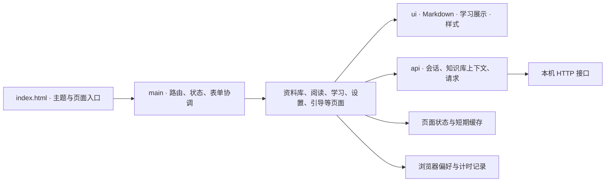

# 网页架构地图

本文只覆盖本机网页客户端。入口是 `public/index.html`，依次加载 `public/web/theme.js`、网页样式和 `public/web/main.mjs`；HTML/CSS/JavaScript 使用浏览器原生能力与 ES 模块，无构建步骤。实际静态、动态模块依赖以 `node scripts/check-architecture.mjs --json` 的输出为准；依赖图是定位工具，不等于运行时、可达功能或验收结论。界面规范见 [UI 指南](UI-DESIGN.md)。

## 模块落点

- `main.mjs` 持有页面路由、页面状态、导航及未保存输入保护；它装配业务模块并分发动作。路由由片段标识决定，页面函数返回 HTML 与可选绑定函数。`parity.mjs` 仍集中知识库、检索、主题、关系和历史等页面；设置、维护在 `management.mjs`，用量页按需加载 `usage-dashboard.mjs`。
- 阅读入口在 `reader.mjs`；`reader-data.mjs` 组织即时投影、详情和关系请求，`reading-content.mjs` 负责展示投影，`reader-actions.mjs` 负责阅读操作与学习条件。`note-editor.mjs` 接入 `public/markdown-editor.mjs`，保存以内容版本检查冲突。阅读正文与展示性整理不改写原文。
- 收集由主入口、`capture-files.mjs` 和 `batch-import.mjs` 协调；处理结果由 `process-outcome.mjs` 展示。学习反馈与轮询在 `learning-display.mjs`、`study-feedback.mjs`、`study-aid.mjs`；计时器与纯状态转换分别在 `focus.mjs`、`focus-model.mjs`，表盘在 `focus-dial.mjs`。学习池、学习会话、读写请求身份和离开时的轮询清理由 `study-workspace.mjs` 管理；页面实际挂载后才发布当前会话。
- 引导由 `onboarding.mjs` 编排，步骤、目标、复习、输出、重学、对话与动效分属 `onboarding-*`；引导读取练习材料并通过请求层切换知识空间，不把引导状态等同正式学习结果。
- `ui.mjs` 提供共享控件、转义后的展示、分页及弹窗；`markdown.mjs` 负责文本渲染和链接限制。样式从入口依次载入 `prototype.css`、`styles.css`、`features.css`、`focus.css`、`controls.css`、`onboarding.css`；用量页另按需载入自己的样式。令牌与参考组件位于 `web/cds/`。类名与加载顺序影响覆盖关系，改共享控件时要同时检查使用页面、深浅色和窄屏。

## 状态、请求与失效

- 主入口的 `state` 管当前路由、初始化数据、页面序列、未保存状态、保存中计数、阅读返回位置、学习会话和滚动位置。导航递增 `sequence`；异步结果须仍属于当前序列才可写页面。离开前检查保存、弹窗及未保存输入；不同页面的临时请求计数不能代替此路由序列。
- `api.mjs` 将会话令牌保存在内存；`practiceId` 标识练习空间，请求进行中拒绝切换，`version` 标识切换，`revision` 随成功写入递增。响应的知识空间版本失效时拒绝使用；仅会话过期且在路由前被拒绝的 GET 最多重新建会话并重读一次，写请求和其他错误不自动重放。页面负责展示错误与明确的恢复操作。
- 阅读缓存限于内存，按知识空间版本、成功写入版本和初始化快照失效，并合并相同详情的并发请求。知识库页面快照也按空间版本与写入版本复用；两者不是资料的权威来源。学习反馈轮询只读当前可见会话，离开后停止，不触发 AI 重试。
- 浏览器 `localStorage` 保存主题、强调色、知识库筛选和引导偏好；计时器记录按资料目录区分并以 Web Locks 协调。`sessionStorage` 的学习辅助标记按学习会话和回答轮次区分。浏览器存储不可用时各模块的表现不同：偏好可回退内存，计时记录读写失败则提示，不能统一吞掉错误。它们不等于服务端资料或完整备份。
- 请求、文件上传和批量导入的回执含义不同：原件上传成功可复用上传身份继续导入；批量文本只继续未确认项目，失败项可能已保存且再次尝试可能增加出处。设置测试与保存有独立确认和结果凭据；恢复先预览、核对并使用该次预览的凭据。不得套用通用自动重试覆盖这些边界。

## 并行实现与决定

`public/web/` 是当前网页入口，根目录下仍有被当前页面复用的材料、编辑器或独立说明页；旧页面文件是否可移除须按实际依赖和路由核对，不能按目录一刀删除。旧 `public/api.mjs` 与 `web/api.mjs`、旧 DOM 控件与新模板字符串控件，拥有不同会话、上传、错误和输出约定；同名不能当成相同接口。`web/markdown.mjs` 的展示渲染与其他编辑/阅读实现也承担不同职责，不能因重复名称合并。任何遗留代码清理须同时核对独立页面、静态资源和测试的真实调用方。

资料类型、学习阶段和深度由 `public/note-classification.mjs` 定义，`web/classification.mjs` 从中生成各视图的显示选项；可练习的阶段子集也来自共享定义，资料是否已被替代等条件由相应入口判断。已删除 `main.mjs` 中被现行路由接管的旧知识库、检索、任务、建主题、打开主题和打开草稿实现。通用控件和分页从业务页移至 `ui.mjs`，学习反馈、完成证据和来源展示移至 `learning-display.mjs`；保留既有样式类、空态及链接处理。批次和验证见[治理进度](ARCHITECTURE_PROGRESS.md)。

## 任务池与启动条件

| 候选 | 证据与决定 | 启动下一批前 |
| --- | --- | --- |
| 页面组合过度集中 | 主入口持有路由、状态、表单及跨页动作；`parity.mjs` 承担多个业务页面。只按完整用户流程拆分，不改变页面合同。 | 先列调用、状态生命周期和退出条件；覆盖导航、未保存保护、过期响应与相关页面。正在进行的拆分以实际结果为准。 |
| 资料成员投影 | `reader-data.mjs` 的即时投影自行按来源和旧键选择、排序，详情随后由接口补齐；不能假设两者规则永远一致。 | 先比较实际输入、摘录过滤、顺序及显示时序，再用合成资料覆盖首次和详情更新；若归属后端合同不清，不在前端单独改变规则。 |
| 重试和恢复 | `api.mjs` 的会话重读、`study-feedback.mjs` 的只读轮询、批量文本与原件的手动续传各有不同含义。保留差异，不建立统一重试器。 | 有具体重复行为或故障证据时，先核对是否可能重复写入、收费或产生额外出处，再分别验证中断、结果未知与用户可见反馈。 |
| 配置与工具 | `main.mjs` 有基础设置，`management.mjs` 有能力配置、连接测试、提示词、维护和恢复；`usage-dashboard.mjs` 独立用量与价格。共享外观控件不代表保存或授权流程相同。 | 先画字段、测试回执、未保存状态与权限依赖，选同语义部分；覆盖配置变更、失败和实际禁用状态，不抽象合并不同安全边界。 |
| 预览验收基础设施 | `parity-preview.mjs` 使用独立合成库和随机回环端口，浏览器脚本的参数、截图位置、拦截及退出方式不同；元数据文件名固定，不能证明并发实例彼此隔离。 | 有实际复用需求时，先定义实例归属、初始化失败清理及单次运行输出，再定向验证失败和关闭；不得连接正式服务或把合成结果当真实验收。 |
| 依赖与遗留清理 | 完整模块引用由架构检查输出，根目录资源仍可能被网页或独立页使用。 | 先读实时依赖、静态 URL 和入口，识别动态加载与样式，再以相关回归和真实页面检查确认；不凭文件名或一次图谱删除。 |

依赖调整后应更新本地图和相关检查，验证只覆盖变更实际影响；涉及页面结果时，还须检查真实页面、键盘/禁用状态与深浅色和窄屏。检查通过、合成预览或当前提交均不代表正式部署或真实供应商验收。
